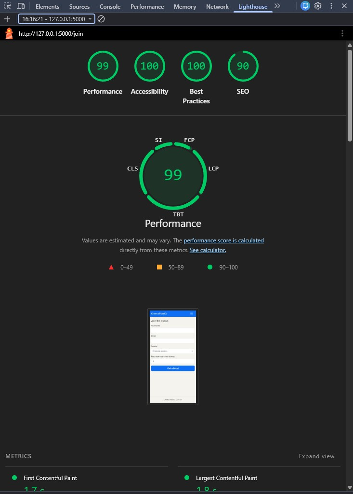
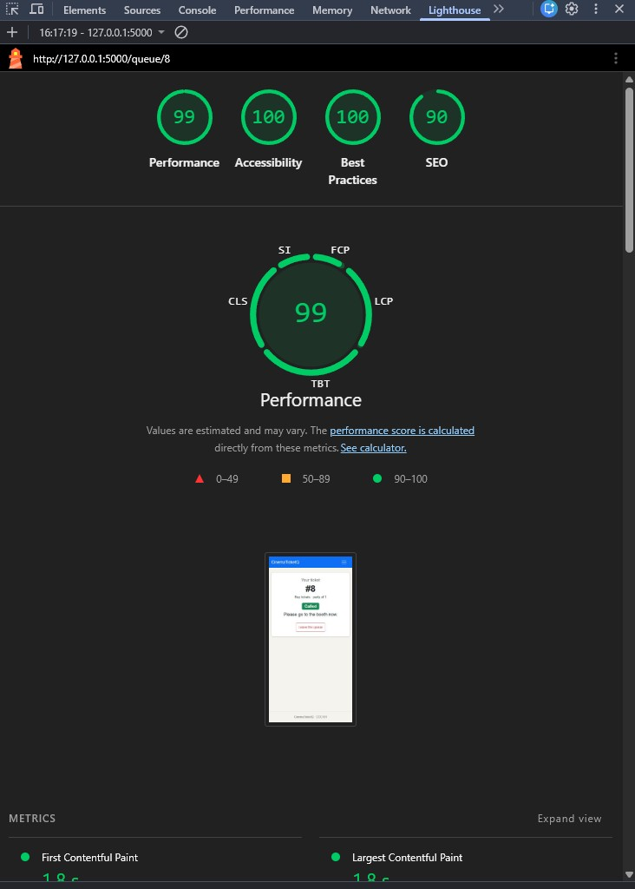
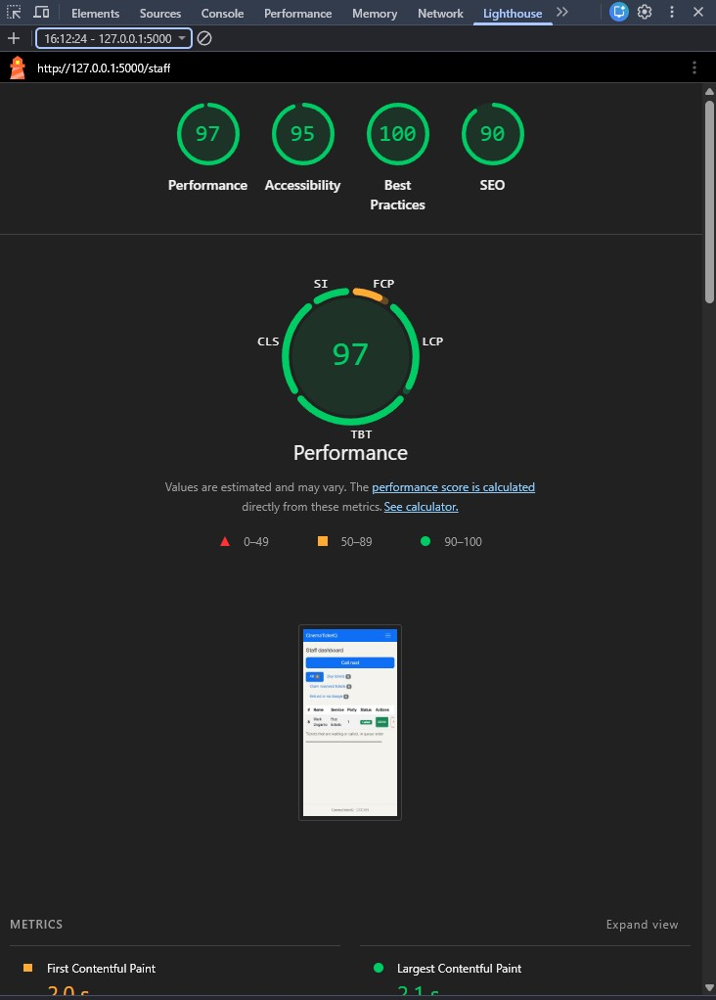

# Accessibility check: CinemaTicketQ

## 9a. Lighthouse (Accessibility, Mobile)

| Screen | URL | Score before | Issues fixed | Score after |
| --- | --- | --- | --- | --- |
| Join | /join | 100 | none | 100 |
| My place | /queue/8 | 100 | none | 100 |
| Staff | /staff | 95 | none | 95 |

Screenshots (final scores):

Anything left under 90 and why: none. All three screens score 90 or higher.

## 9b. Keyboard-only test

**Task 1: join the queue from the home page**
- Skip link appears on the first Tab: yes
- Focus always visible: yes
- Could reach and use every control: yes
- Problems found and fix: none

**Task 2: staff filters by a service, calls a ticket, serves it**
- Focus always visible: yes
- Could reach and use every control: yes
- Problems found and fix: none

## 9c. Manual checklist

| Check | Join | My place | Staff |
| --- | --- | --- | --- |
| Every input has a visible label | ✅ | n/a | n/a |
| Error messages say what to do, in text | ✅ | n/a | n/a |
| Status is shown in words, not only color | n/a | ✅ | ✅ |
| Text and buttons readable at 375 px, no sideways page scroll | ✅ | ✅ | ✅ (only the table scrolls, inside its own box) |
| Buttons are at least about 44 × 44 px on a phone | ✅ | ✅ | ✅ |
| Page has one `<h1>` and headings in order | ✅ | ✅ | ✅ |
| `<html lang="en">` is set | ✅ | ✅ | ✅ |

Fixes made: none needed.