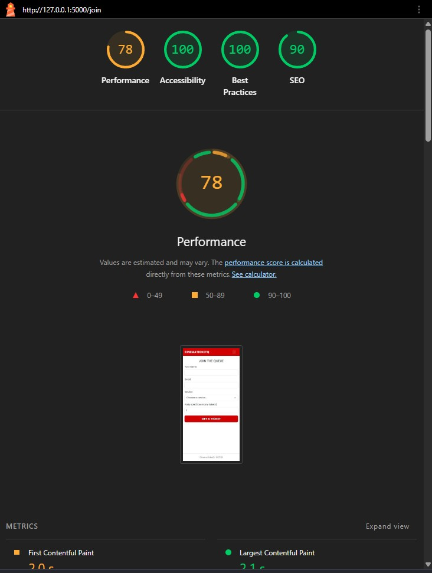
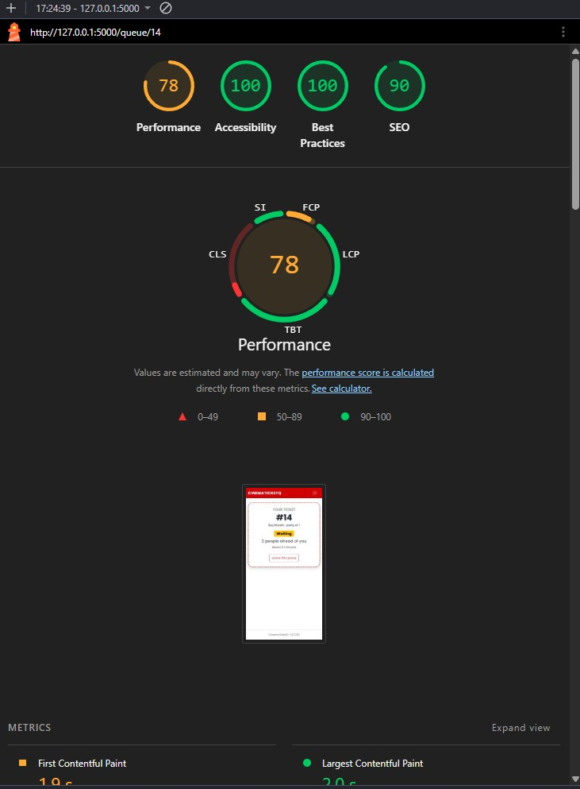
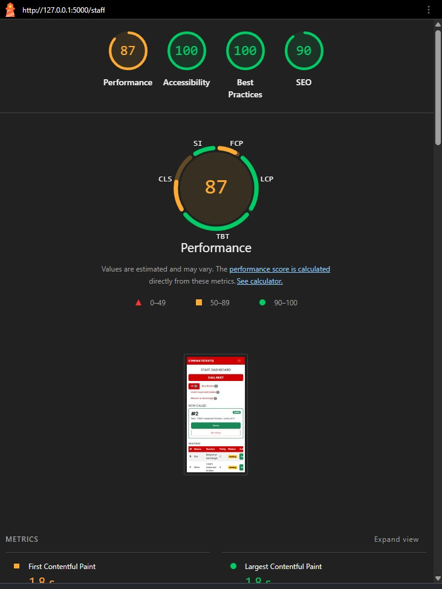

# Accessibility check: CinemaTicketQ

## 9a. Lighthouse (Accessibility, Mobile)

Lighthouse was run twice on the same three screens: first on the generic Bootstrap look, then after the red cinema theme and the staff cards.

### Accessibility scores

| Screen | URL | Generic (before) | Red theme (after) | Issues fixed |
| --- | --- | --- | --- | --- |
| Join | /join | 100 | 100 | none needed |
| My place | /queue/14 (earlier run: /queue/8) | 100 | 100 | none needed |
| Staff | /staff | 95 | 100 | none needed (already above 90 before) |

All screens meet the target of 90 or higher in both runs. The Staff page improved from 95 to 100 after the redesign.

### Other Lighthouse scores (for reference)

| Screen | Performance before | Performance after | Best Practices | SEO |
| --- | --- | --- | --- | --- |
| Join | 99 | 78 | 100 | 90 |
| My place | 99 | 78 | 100 | 90 |
| Staff | 97 | 87 | 100 | 90 |

Performance is not part of this check, but it dropped after the redesign. The likely cause is the web font loaded from Google Fonts, which slows the first paint on a slow connection. The page still uses fallback fonts if the font fails to load.

### Screenshots

**Generic Bootstrap look (before)**

| Join | My place | Staff |
| --- | --- | --- |
|  |  |  |

**Red cinema theme (after)**

| Join | My place | Staff |
| --- | --- | --- |
|  |  |  |

Anything left under 90 and why: none. All three screens score 90 or higher in both runs.

## 9b. Keyboard-only test

**Task 1: join the queue from the home page**
- Skip link appears on the first Tab: yes
- Focus always visible: yes
- Could reach and use every control: yes
- Problems found and fix: none

**Task 2: staff filters by a service, calls a ticket, serves it**
- Focus always visible: yes
- Could reach and use every control: yes
- Problems found and fix: none

## 9c. Manual checklist

| Check | Join | My place | Staff |
| --- | --- | --- | --- |
| Every input has a visible label | ✅ | n/a | n/a |
| Error messages say what to do, in text | ✅ | n/a | n/a |
| Status is shown in words, not only color | n/a | ✅ | ✅ |
| Text and buttons readable at 375 px, no sideways page scroll | ✅ | ✅ | ✅ (only the table scrolls, inside its own box) |
| Buttons are at least about 44 × 44 px on a phone | ✅ | ✅ | ✅ |
| Page has one `<h1>` and headings in order | ✅ | ✅ | ✅ |
| `<html lang="en">` is set | ✅ | ✅ | ✅ |

Fixes made: none needed.