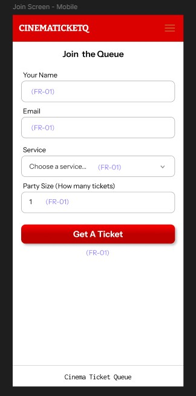
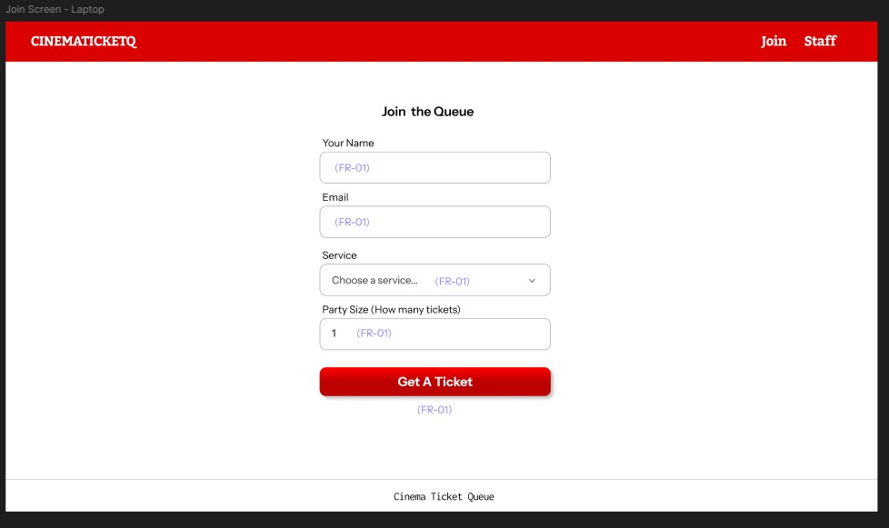
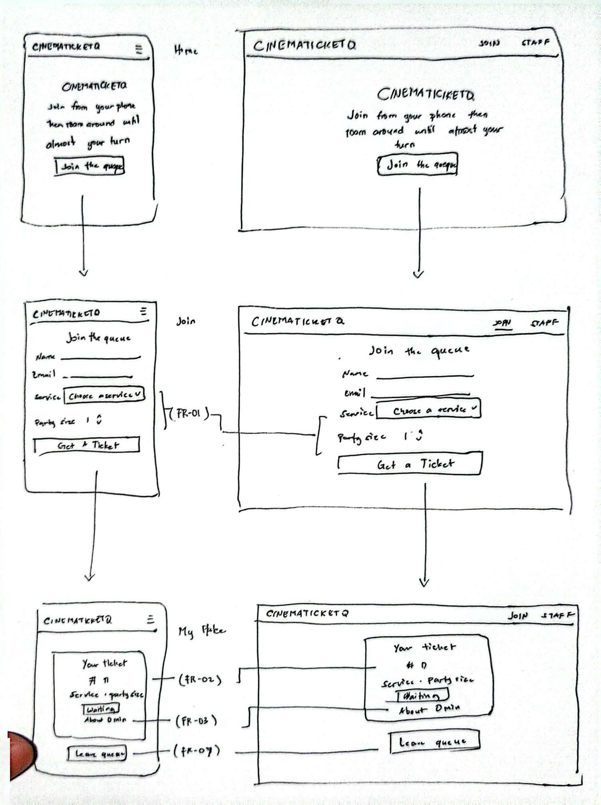
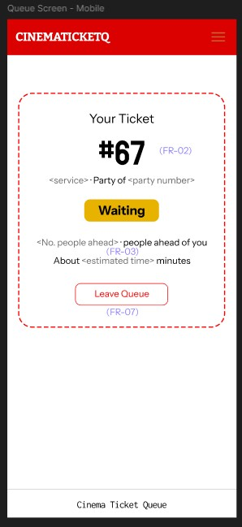
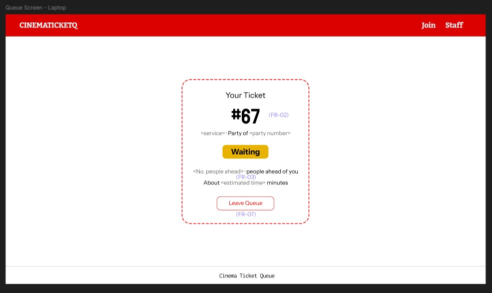
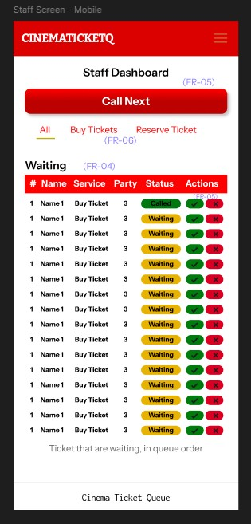
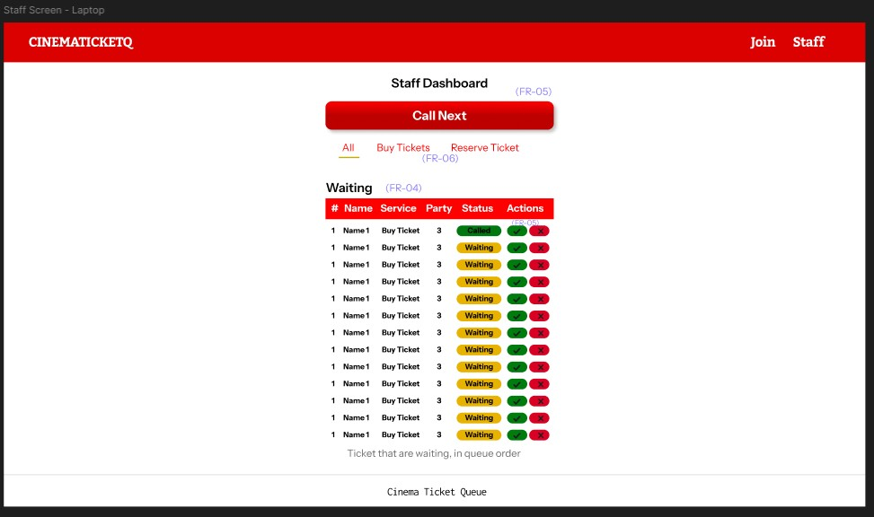
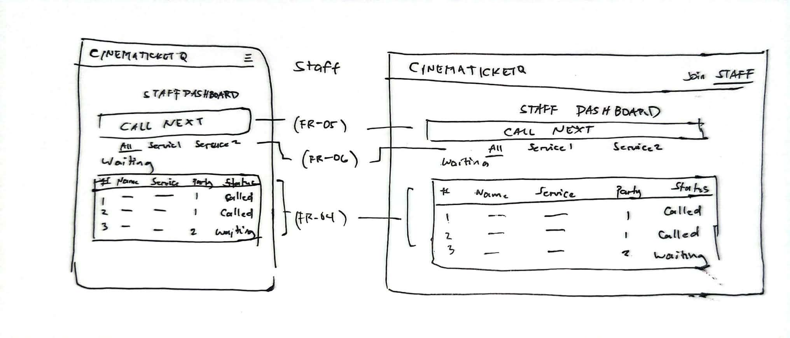

# Week 3: Wireframe Self-Review

Reviewed against the personas Sandy (person waiting) and Wanda (staff member), on both the phone and laptop frames.

I drew two versions of the wireframes:

1. **First draft:** hand-drawn sketches, `wireframes/All-Join.jpg` (Home, Join, My Place) and `wireframes/All-Staff.jpg` (Staff dashboard).
2. **Updated version:** six digital frames, made after this review.

| Frame | Persona | Device | Requirements | File |
| --- | --- | --- | --- | --- |
| Join | Sandy | Phone | FR-01 | `wireframes/join-mobile.jpg` |
| Join | Sandy | Laptop | FR-01 | `wireframes/join-laptop.jpg` |
| My Place | Sandy | Phone | FR-02, FR-03, FR-07 | `wireframes/queue-mobile.jpg` |
| My Place | Sandy | Laptop | FR-02, FR-03, FR-07 | `wireframes/queue-laptop.jpg` |
| Staff dashboard | Wanda | Phone | FR-04, FR-05, FR-06 | `wireframes/staff-mobile.jpg` |
| Staff dashboard | Wanda | Laptop | FR-04, FR-05, FR-06 | `wireframes/staff-laptop.jpg` |

**Main flows:** Sandy goes from Home → Join → My Place. Wanda opens the Staff dashboard → Call next → Serve.

## 1. Join the Queue (Sandy; FR-01)

**Wireframes reviewed:**

- First draft (sketch, phone and laptop): `wireframes/All-Join.jpg`
- Updated (digital): `wireframes/join-mobile.jpg` and `wireframes/join-laptop.jpg`

| Phone | Laptop |
| --- | --- |
|  |  |

**Works well**
The form has only four fields (name, email, service, party size) and one large "Get a Ticket" button. On the phone the button is full width, so Sandy can finish in seconds with one hand, which follows my rule that her hands are often full. The laptop version keeps the same order in a narrower centered column, so nothing has to be relearned.

**Problem**
Sandy has to type her email on a phone keyboard while holding food or bags, and a wrong entry would only show up after she submits. This breaks *error prevention*.

**Change**
In the digital frames every field is a large full-width box with its label above it, so each target is easy to tap. I kept the field count at four, and the build uses the right input types (email, number) and shows an error under any wrong field while keeping what she typed. Those behaviors are not visible in a wireframe, so I checked them in the running app.

## 2. My Place (Sandy; FR-02, FR-03, FR-07)

**Wireframes reviewed:**

- First draft (sketch, phone and laptop): `wireframes/All-Join.jpg` (bottom row)
- Updated (digital): `wireframes/queue-mobile.jpg` and `wireframes/queue-laptop.jpg`

| Phone | Laptop |
| --- | --- |
|  |  |

**Works well**
The ticket number is the biggest element, followed by the status, people ahead and estimated wait. Sandy can see her place at a glance while walking around the mall, which follows my rule that the number, position and wait time must be the biggest things on screen.

**Problem**
The estimated wait could be read as a promise, and if the line moves slower than expected Sandy may lose trust. This breaks *visibility of system status*. In the sketch, the "Leave queue" button also sat close to the ticket information and could be tapped by mistake, which breaks *error prevention*.

**Change**
The digital frames word the estimate as "About … minutes" instead of an exact time. The status is a badge with the word "Waiting", so it does not rely on color alone. "Leave Queue" is an outlined red button at the bottom of the card, visually weaker than the ticket information, so it is less likely to be tapped by mistake.

## 3. Staff Dashboard (Wanda; FR-04, FR-05, FR-06)

**Wireframes reviewed:**

- First draft (sketch, phone and laptop): `wireframes/All-Staff.jpg`
- Updated (digital): `wireframes/staff-mobile.jpg` and `wireframes/staff-laptop.jpg`

| Phone | Laptop |
| --- | --- |
|  |  |

**Works well**
"Call Next" is a large button at the top, directly under the heading, so Wanda can act in one tap between customers. This follows my rule that her counter is busy and she has only seconds. The service filter sits right below it, so she can switch lines without searching, and the waiting list is shown in queue order.

**Problem**
My first sketch listed the queue and each ticket's status but had no way to act on a single row, so Wanda would have had no quick way to mark someone served or a no-show. Once actions are added, two buttons side by side on a busy counter risk the wrong tap, which breaks *error prevention*. The button wording also has to match what she says at the counter, which is *match between the system and the real world*.

**Change**
The digital frames add an Actions column to every row, with a green check and a red X in different colors so they are hard to confuse, and the status badges are also color-coded and worded ("Called", "Waiting"). Because icons alone rely on recall, the built app uses the words "Serve" and "No-show" on the buttons, and the main action is called "Call next" everywhere.

## Summary

After reviewing the three screens, I updated my wireframes based on the problems I identified. These changes aim to make the application easier to understand and use on both phone and laptop screens.

The most important improvement was on the Staff dashboard: the first sketch had no way to act on a ticket, so I added a per-row Actions column and kept "Call Next" as the largest control. On My Place, showing the wait as "About … minutes" with the status written out lets Sandy trust what she sees when she is not watching the screen.