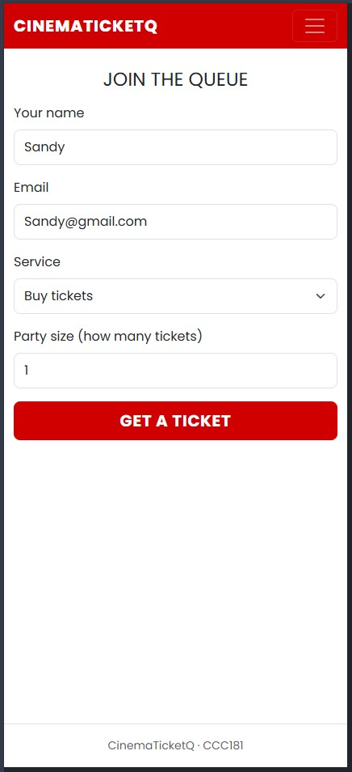
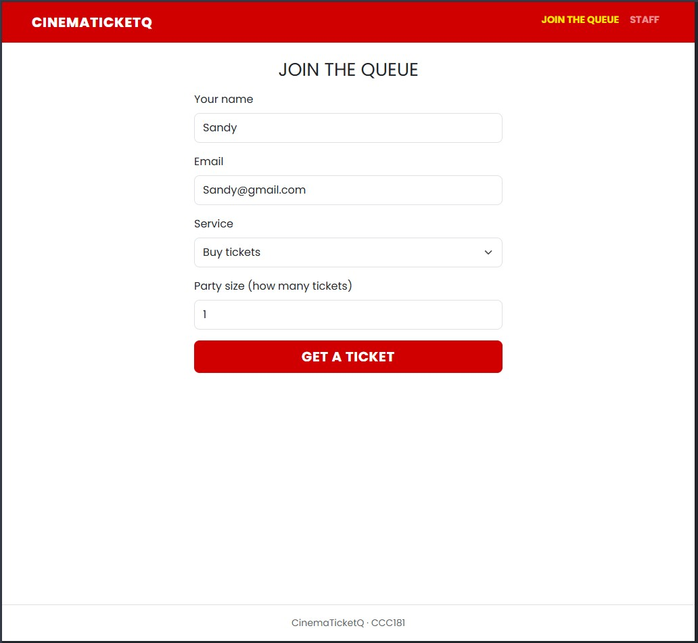
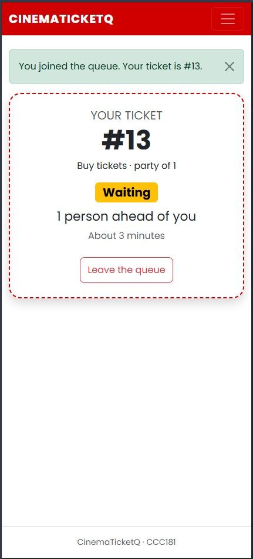
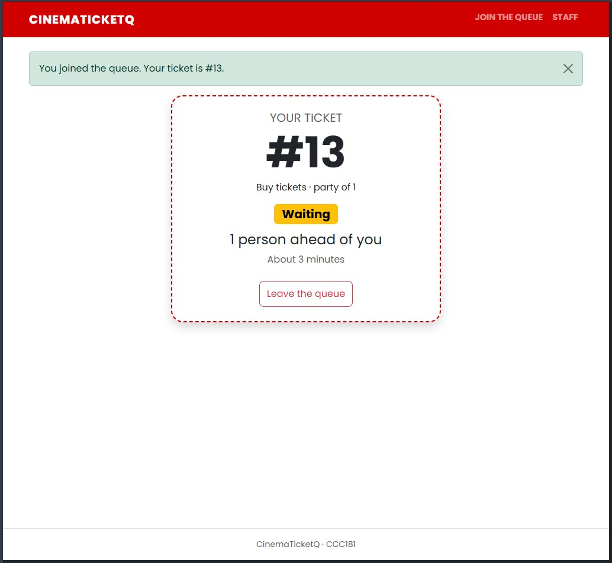
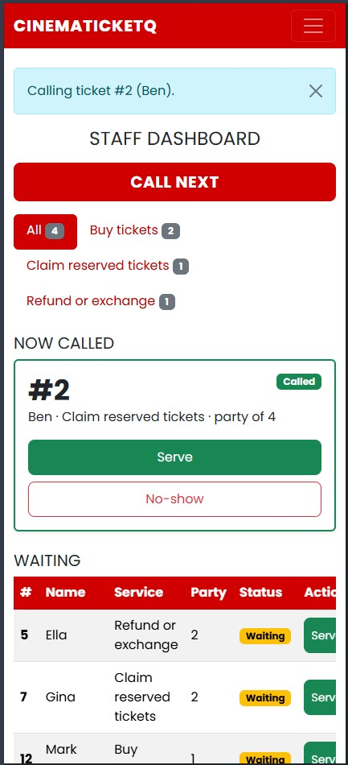
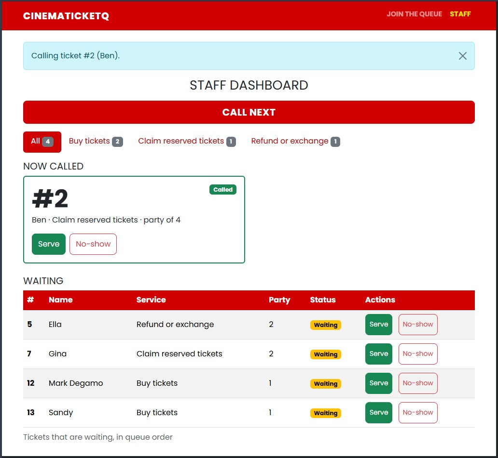

# Week 3 Report: CinemaTicketQ

## Title details

- **App:** CinemaTicketQ
- **Setting:** Cinema ticket booth queue at a mall (Robinsons Iligan Movie World). The app manages the waiting line only; tickets are still bought at the booth.
- **Overview:** People scan a QR code, join a queue for a service, and see their ticket number, status, people ahead and an estimated wait, so they can roam the mall until they are called. Booth staff see the queue, call the next person, and mark tickets served or no-show.
- **Name:** Rey Mark E. Degamo
- **Student ID:** 2024-0664
- **Section:** CCC181 - CS3B
- **Date:** October 25, 2026
- **Note:** The queue starts with sample tickets for demo purposes, and the staff dashboard has no login yet.

## Personas

Full personas: [personas.md](personas.md)

- **Sandy, the person waiting.** "I hate long line just to buy tickets." Top tasks: join the queue (FR-01), check number and people ahead (FR-02), see estimated wait (FR-03), leave the queue (FR-07).
- **Wanda, the staff member.** "Why does people even cut in line? complains are so frustrating." Top tasks: see the waiting list in order (FR-04), call next, serve or mark no-show (FR-05), filter by service (FR-06).

## Screens

| Screen | Phone (375 px) | Laptop |
| --- | --- | --- |
| **Join** |  |  |
| **My place** |  |  |
| **Staff dashboard** |  |  |

| Screen | Persona | Requirements | What it shows |
| --- | --- | --- | --- |
| Join | Sandy | FR-01 | Sandy joins the queue from her phone by entering her name, an optional email, a service and her party size. On a laptop the same form sits in a narrower centered column. |
| My place | Sandy | FR-02, FR-03, FR-07 | Sandy checks her ticket number, status, people ahead and estimated wait while walking around the mall, and can leave the queue. The page updates by itself every 10 seconds. |
| Staff dashboard | Wanda | FR-04, FR-05, FR-06 | Wanda sees the waiting list in order, filters by service, and calls, serves or marks no-shows. A called ticket shows as a card above the waiting list. |

## Design decisions

1. **Ticket number, status and wait are the largest things on My place.** Sandy's hands are often full and she walks around the mall, so she must see her position at a glance (persona rule 1).
2. **"Call next" is a large button at the top of the staff dashboard.** Wanda has only seconds between customers (persona rule 1).
3. **The wait is shown as "About X minutes", and the status uses words, not only color.** My self-review noted that an exact time reads like a promise, and that Sandy may be far from the booth when she is called.
4. **The called ticket appears as a card above the waiting table.** The person Wanda just called must be easy to see and act on, so Serve and No-show sit on the card (persona rule 2).

## Self-review

Full review: [feedback.md](feedback.md). I drew a hand-drawn first draft (`wireframes/All-Join.jpg`, `wireframes/All-Staff.jpg`), reviewed it against the personas, then made six digital frames with the changes.

| Screen | Wireframes (phone and laptop) |
| --- | --- |
| Join | [join-mobile.jpg](wireframes/join-mobile.jpg), [join-laptop.jpg](wireframes/join-laptop.jpg) |
| My place | [queue-mobile.jpg](wireframes/queue-mobile.jpg), [queue-laptop.jpg](wireframes/queue-laptop.jpg) |
| Staff dashboard | [staff-mobile.jpg](wireframes/staff-mobile.jpg), [staff-laptop.jpg](wireframes/staff-laptop.jpg) |

Main problems and what I changed:

- **Join:** typing on a phone with one hand risks mistakes (*error prevention*). The digital frames use large full-width fields with the label above each one, and I kept the form to four fields. In the app I added the right input types and an error under each wrong field, keeping what was typed.
- **My place:** the estimate could read as a promise (*visibility of system status*), and "Leave queue" sat close to the ticket information in my sketch. The digital frames word the wait as "About … minutes", show the status as a word badge, and put an outlined "Leave Queue" button at the bottom of the card.
- **Staff:** my first sketch had no way to act on a single ticket. The digital frames add an Actions column with a green check and a red X in different colors, and the built app uses the words "Serve" and "No-show" because icons alone rely on recall. The main action is called "Call next" everywhere (*match with the real world*).

## Accessibility

Lighthouse accessibility scores (mobile), measured twice. With the generic Bootstrap look: Join 100, My place 100, Staff 95. After the red theme and staff cards: Join 100, My place 100, Staff 100. All pass the 90 target. The keyboard-only test and the manual checklist found no problems. Full notes: [accessibility.md](accessibility.md).

Most important point: the Staff page went from 95 to 100 after the redesign, so the theme and cards did not hurt accessibility. Buttons and form fields have a minimum height of about 44 px for touch.

Performance (not part of this check) dropped from 97-99 to 78-87 after the redesign. The likely cause is the Poppins web font loaded from Google Fonts, which I did not test separately. The page falls back to Arial if the font does not load.

## Usability test

Full notes: [usability-test.md](usability-test.md). One tester, in person, on a phone connected to the same Wi-Fi as the app.

| Task | Finished | Time |
| --- | --- | --- |
| 1. Join the queue | Yes | About 35 seconds |
| 2. Find number and people ahead | Yes | About 3 seconds |
| 3. Call next and mark served | Yes | About 45 seconds |

**Improvement 1: feedback on staff buttons.** After clicking Call next, nothing changed for about a second, so the tester thought the button did not work. Staff buttons now disable and show "Please wait…" on click (`static/js/main.js`).

| Before | After |
| --- | --- |
|  |  |

**Improvement 2: optional email.** The tester did not understand why the join form asks for an email. The email is now optional, labeled "Email (optional)", with the line "Only used to contact you about your ticket." If filled in, it is still checked on the server (`app.py`, `templates/join.html`).

| Before | After |
| --- | --- |
|  |  |

**Additional changes (my own review, not from the tester):** a red cinema theme, and called tickets shown as cards on the staff dashboard. See [usability-test.md](usability-test.md).

## Reflection

- **Hardest this week:** Getting started with limited time and starting Week 3 from scratch, then making the app look like a cinema service instead of generic Bootstrap.
- **What I will change in Week 4 when tickets move to a database:** replace the `TICKETS` list with database queries, calculate position and wait time with SQL, keep ticket numbers unique, and keep tickets after the server restarts.
- **Further improvement, a staff login screen:** the staff dashboard is currently open to anyone who knows the `/staff` address. Once staff accounts can be stored in the database, I plan to add a login screen so only booth staff can call, serve or mark tickets, and to hide the Staff link from customers.

## Declaration

I acknowledge the use of ChatGPT as an AI-assisted tool during the development of this project. It was use to help me organize the entire task and help me understand each part, Also used to create a structure md for feedback.md, usability-test.md, and report.md. I remain responsible for the final content for each markdown files.