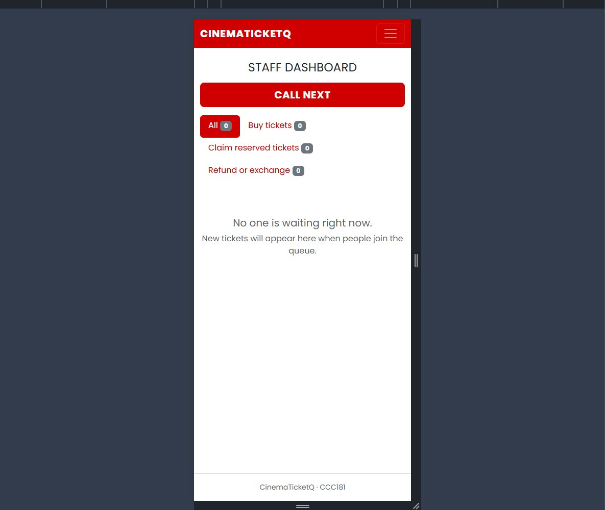
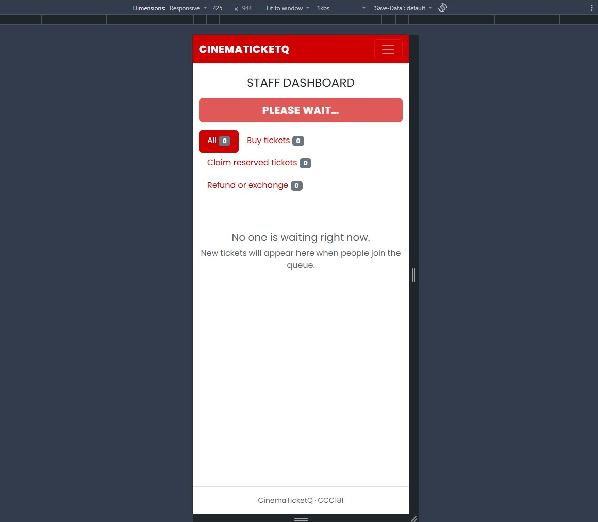
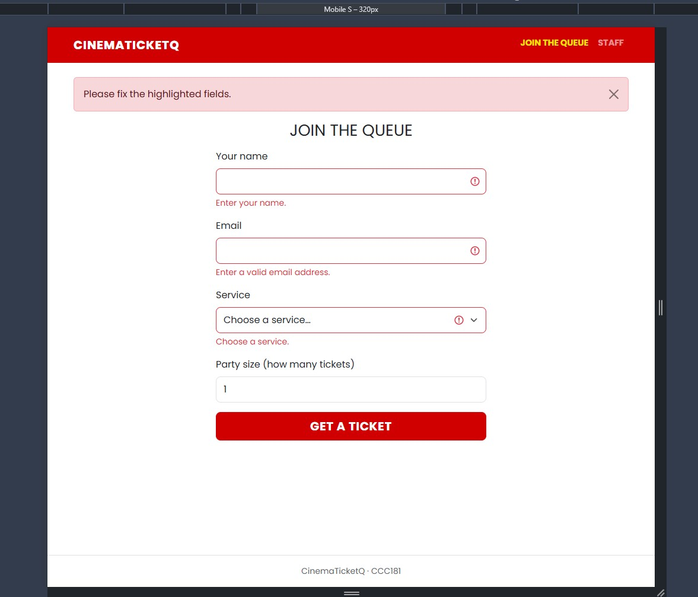
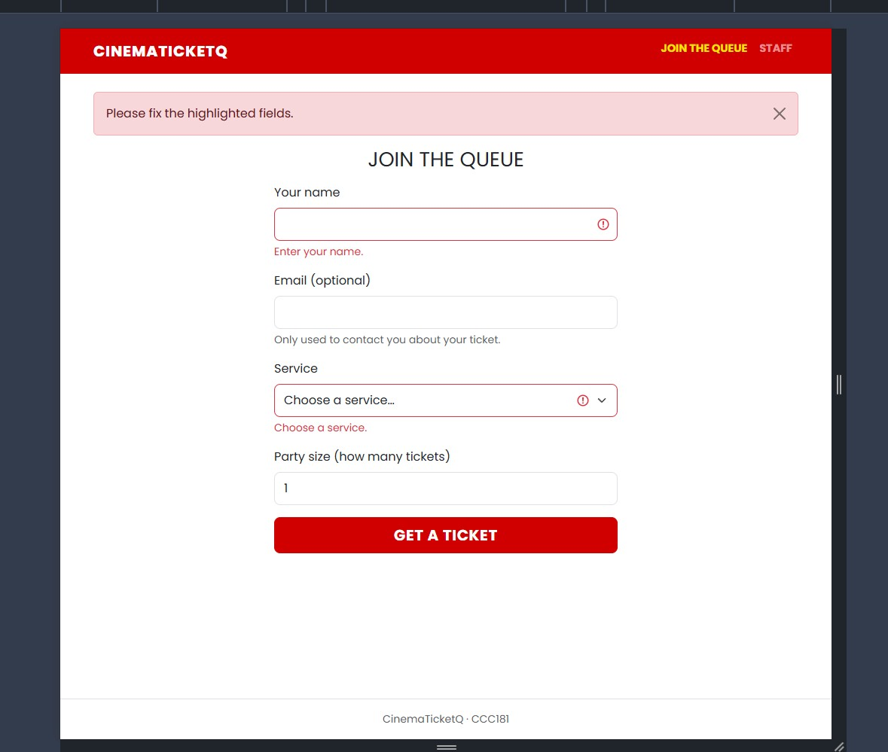
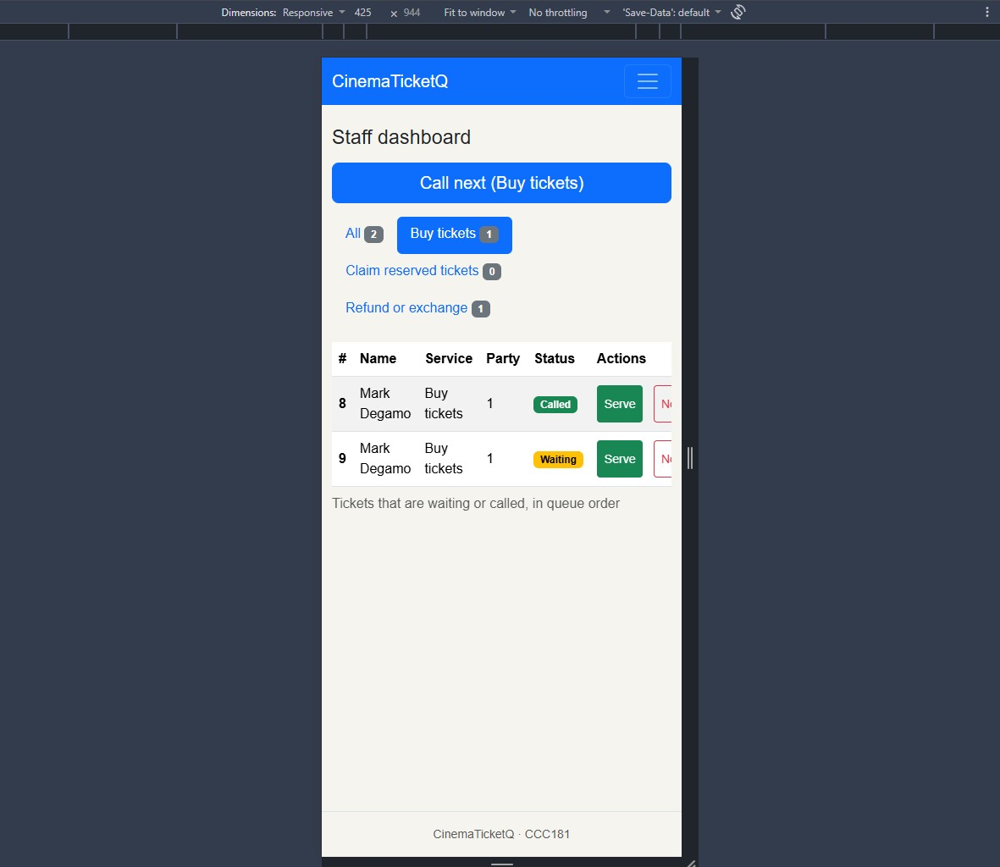
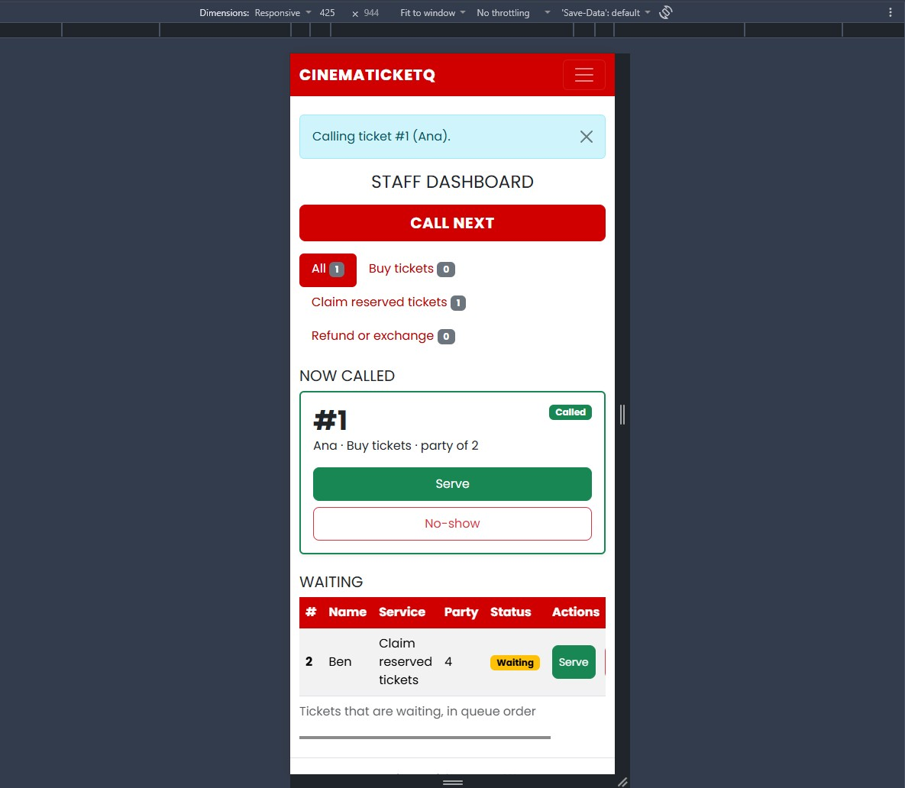

# Usability Test Report

## 1. Objective

The purpose of this usability test is to evaluate whether users can understand and use CinemaTicketQ, the queue management app for a cinema ticket booth. The test focuses on joining the queue, checking queue position, and managing the queue through the staff dashboard.

## 2. Participants

- **Number of participants:** 1
- **Participant profile:** Resheill, who matches the persona Sandy because she frequently goes to the cinema at Robinsons Iligan
- **Testing method:** In person, on a phone connected to the same Wi-Fi as the app
- **Recording:** Permission asked; screen recording only (no face or voice)

## 3. Tasks

Participants were asked to complete the following tasks:

1. "You just arrived. Get in line for Buy tickets."
2. "How many people are ahead of you? What is your number?"
3. "Pretend you are the staff member. Call the next person and mark them as served."

## 4. Test Results

### Task 1: Join the Queue

- **Result:** Completed (about 35 seconds)
- **Observations:** The tester filled in the form and got a ticket without help. They were surprised that the form asks for an email and wondered why it was needed.
- **Problems encountered:** The email field was unexpected and unexplained. Sandy's "few fields, one hand" rule mostly held, but this field broke it.
- **Suggested improvement:** Make the email optional and explain why it is asked. This was done (see Improvements Made).

### Task 2: Check My Place

- **Result:** Completed (about 3 seconds)
- **Observations:** The tester found their ticket number (#11) right away. Sandy's rule that the number, position and wait must be the biggest things on My place held.
- **Problems encountered:** None.
- **Suggested improvement:** None.

### Task 3: Use the Staff Dashboard

- **Result:** Completed (about 45 seconds)
- **Observations:** After pressing **Call next**, the tester was surprised that nothing seemed to happen. The response took about a second, probably because the app runs in debug mode on a local server. Wanda's "one tap" rule held.
- **Problems encountered:** There was no feedback after the tap, so the tester thought the button had not worked.
- **Suggested improvement:** Give immediate feedback when a staff button is pressed, for example by disabling it and changing its text.

## 5. Key Findings

### What Worked Well
- The tester found their ticket number and place in about 3 seconds, so the large number and status on My place were easy to understand.
- All three tasks were completed without help.

### Problems Identified
- **Most serious:** after clicking **Call next**, nothing changed on screen for about a second, so the tester thought the button did not work. This affects Wanda, who has only seconds between customers, and it breaks the usability principle of visibility of system status.
- The email field on the join form was unexpected and unexplained.

## 6. Improvements Made

| Issue Identified | Improvement |
|---|---|
| No feedback after clicking Call next, Serve or No-show | In `static/js/main.js`, each staff form now disables its button and shows "Please wait…" when it is submitted. This also prevents accidental double taps. |
| The email field was unexpected and unexplained | The email is now optional, labeled "Email (optional)", with the line "Only used to contact you about your ticket." If filled in, it is still checked on the server. Changed in `app.py` and `templates/join.html`. |

**Staff buttons: before and after**

| Before | After |
| --- | --- |
|  |  |

**Email field: before and after**

| Before | After |
| --- | --- |
|  |  |

### Additional changes

These came from my own review, not from the tester. I made them before running the test a second time with a different person.

| Change | Detail |
|---|---|
| Cinema theme | Red navbar, uppercase links, red headings and a dashed ticket-stub card on My place, so the app looks like a cinema service instead of default Bootstrap. Changed in `static/css/style.css`. |
| Called tickets shown as cards | On the staff dashboard, a called ticket now moves out of the table into a green card with Serve and No-show buttons, and the table lists only people still waiting. Changed in `templates/staff.html`. |

| Before | After |
| --- | --- |
|  |  |

## 7. Conclusion

The usability test helped identify areas where CinemaTicketQ could be improved. Based on the observations, the staff buttons now give immediate feedback, which fixes the most serious problem. The email field was made optional and explained.