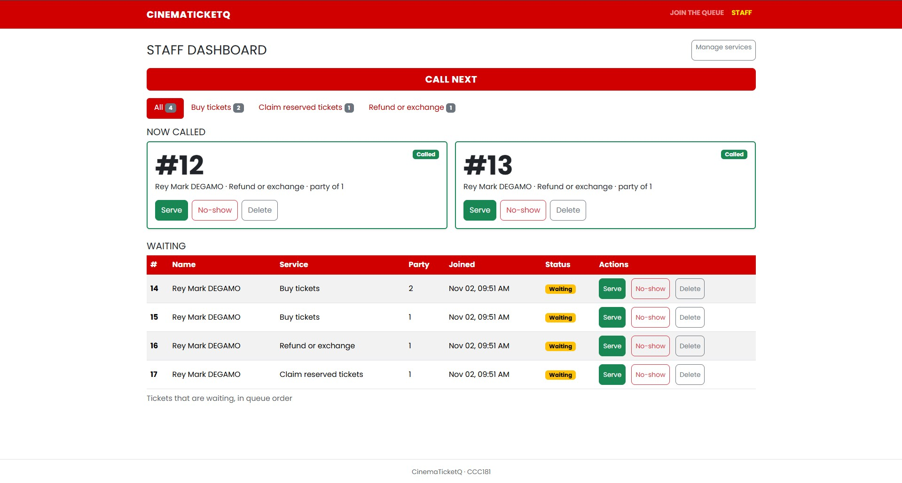
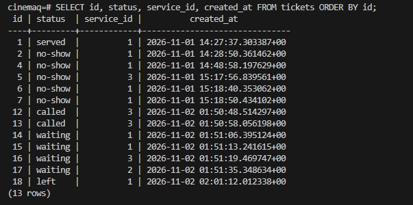
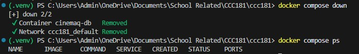
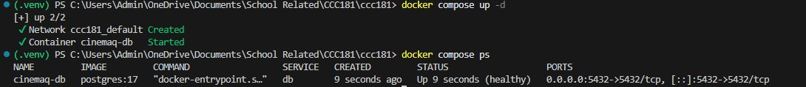
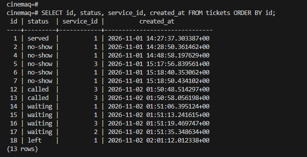

# Persistence proof: CinemaTicketQ

This checks NFR-01: no ticket is lost when the Flask server or the database restarts.

## 11a. Restart test

### Before the restart

I had 13 tickets across 3 services (Buy tickets, Claim reserved tickets, Refund or exchange). One ticket was served, two were called, four were waiting, five were no-shows and one person had left the queue (ticket #18, status `left`).

Query used:

```sql
SELECT id, status, service_id, created_at FROM tickets ORDER BY id;
```





### Steps

1. Stopped Flask with Ctrl+C.
2. Ran `docker compose down`. The container and the network were removed.
3. Ran `docker compose ps`, and nothing was running.

   

4. Ran `docker compose up -d` and waited until `docker compose ps` said `healthy`.

   

5. Started Flask again with `flask --app app run --debug`.

I did not use `down -v`, so the `pgdata` volume kept the data.

### After the restart




**Result:** Every ticket id, status, service and `created_at` time was the same before and after the restart, and both queries returned 13 rows, including ticket #18 with status `left`. The staff dashboard still showed tickets #12 and #13 as called and tickets #14 to #17 as waiting. NFR-01 passed.

## 11b. Rebuild from scratch

I deleted the database volume and rebuilt everything from my migrations:

```
    docker compose down -v
```
```
    docker compose up -d
```
    (waited for healthy)
```
    flask --app app db upgrade
```
```
    flask --app app seed
```

Both migrations ran and created `users`, `services` and `tickets`. The seed added my three services. The app opened, the join form listed the services, and I could join and get a ticket.

My first attempt ran all four commands at once, so `db upgrade` ran before the new database was ready and the seed failed. After I waited for `healthy` and ran the commands one at a time, it worked.   