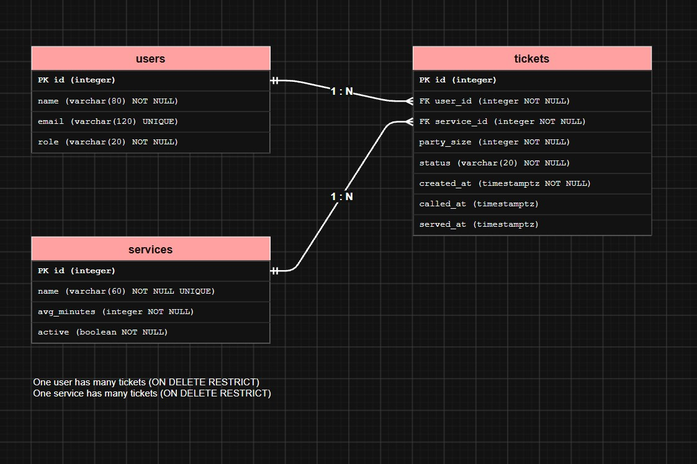
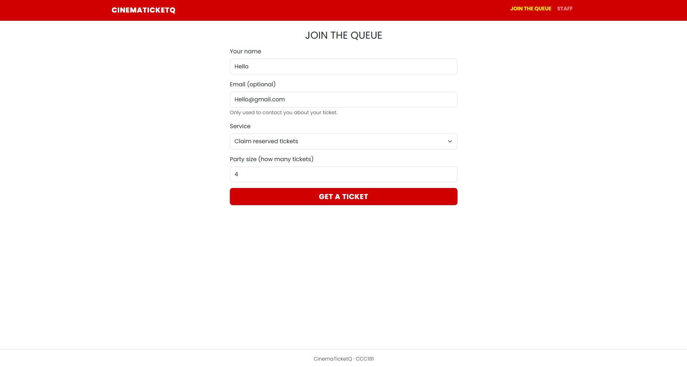
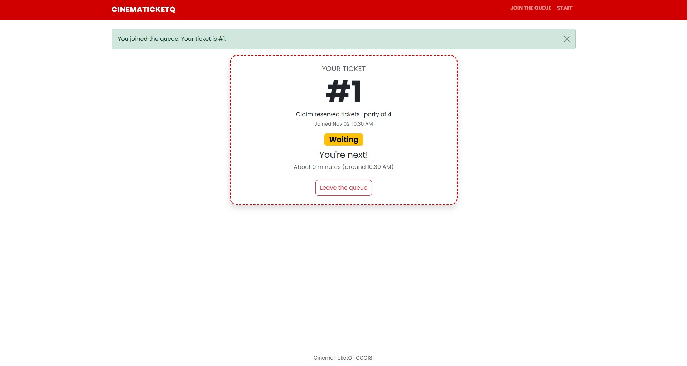
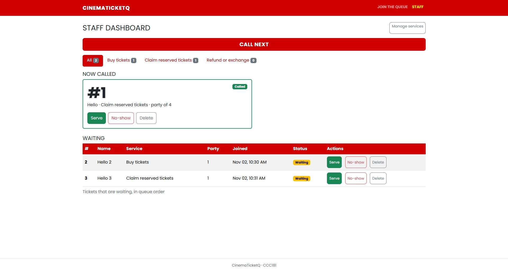
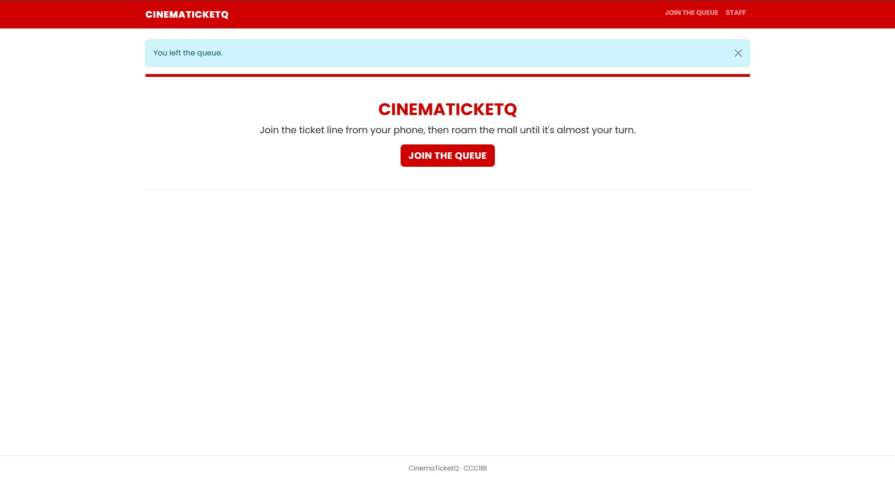
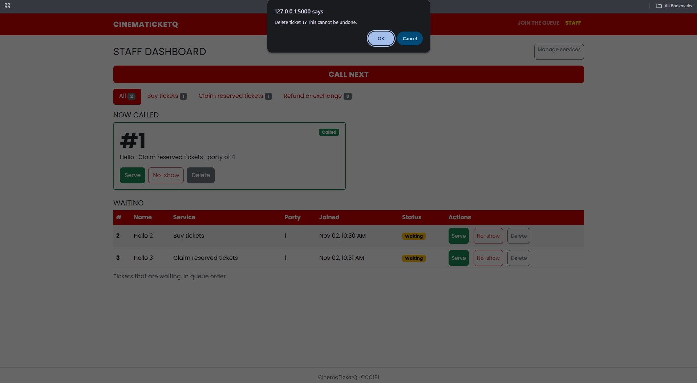
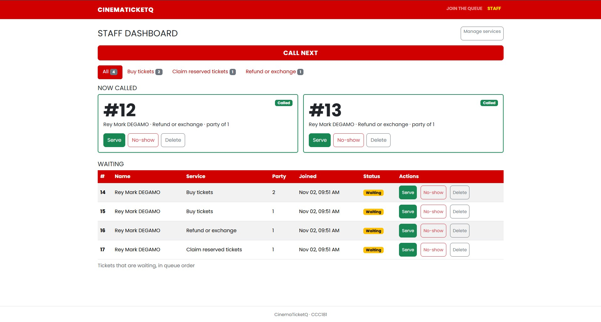
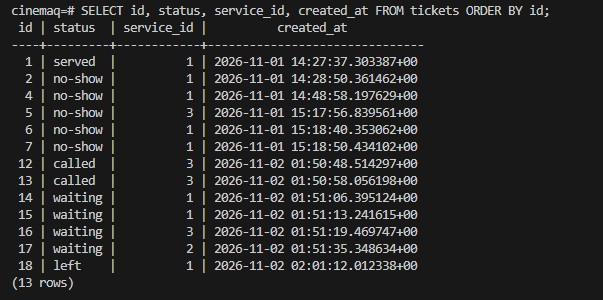
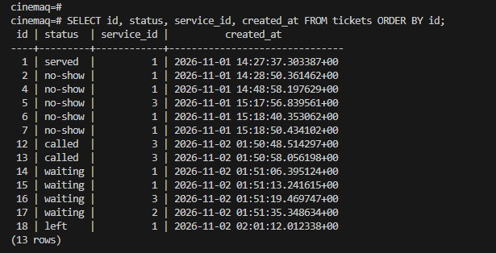

# Week 4 report: CinemaTicketQ

## Title details

- **App:** CinemaTicketQ
- **Setting:** Cinema ticket booth at a mall (Robinsons Iligan Movie World)
- **Name:** Rey Mark E. Degamo
- **Student ID:** 2024-0664
- **Section:** CCC181 - CS3B
- **Date:** November 2, 2026
- **Pull Request** https://github.com/Mark-Degams/ccc181/pull/4
- **Database:** PostgreSQL in Docker Compose

## Requirements

I wrote **15 functional** and **6 non-functional** requirements. Full list: [docs/requirements.md](../requirements.md).

**MVP:** FR-01, FR-02, FR-03, FR-04, FR-05, FR-06, FR-07, FR-09, FR-10, NFR-01, NFR-02, NFR-04, NFR-05.

**What people from my setting said, and what I changed:**

| Said | Changed |
| --- | --- |
| "If my number is almost up, I want a notification or a vibration." | Added FR-15 (banner and vibration when 3 or fewer are ahead). SMS and push stay out of scope. |
| "The estimate can be wrong when the movie is about to start." | Changed FR-03 and added FR-14: the estimate uses the average time per person of the last 10 served tickets. Added `served_at` to the schema. |
| "Most important: how many ahead, joining easily, leaving the line." | Checked FR-01, FR-02 and FR-07 are Must and in the MVP. No change. |

## ERD

- One user has many tickets (1 : N).
- One service has many tickets (1 : N).
- Each ticket belongs to exactly one user and one service.
- The foreign keys sit on the "many" side: `tickets.user_id` and `tickets.service_id`.

Full design: [docs/week4/schema.md](schema.md).

## Schema

## Design decisions

1. **`party_size` is on `tickets`, not `users`.** A person may come alone one visit and with a group the next (FR-10).
2. **`called_at` and `served_at` are stored, and the wait estimate is computed.** The booth user needs an estimate that follows real speed (FR-03, FR-14), and a stored estimate would go out of date.
3. **Services are switched off with `active`, not deleted, and the foreign keys use `ON DELETE RESTRICT`.** Old tickets are needed for reports (FR-09, FR-12).

## Self-review

Full text: [docs/week4/schema-review.md](schema-review.md).

- **Unused column:** removed `users.role`, since no requirement needs it until staff login in Week 11.
- **Status and times could disagree:** added `ck_tickets_called_time` and `ck_tickets_served_time`. Serving a waiting ticket now sets both times, and the FR-14 average ignores tickets with a time of 0.
- **Same email, new name:** the `join` route now updates `users.name`, so the latest name is the only one stored.
- **Kept on purpose:** people with no email get a new `users` row each visit, because joining quickly matters more than linking visits.

## Migrations

| File | What it does |
| --- | --- |
| `migrations/versions/<first>.py` | Creates the `users`, `services` and `tickets` tables with their primary keys, foreign keys, UNIQUE and CHECK constraints. |
| `migrations/versions/<second>.py` | Adds the `active` column to `services` so a service can be switched off (FR-09). |

## CRUD

| Operation | Route | Requirement | Screenshot |
| --- | --- | --- | --- |
| Create | `POST /join` | FR-01 |  |
| Read | `GET /queue/<id>` | FR-02, FR-03 |  |
| Update | `POST /staff/call-next`, `POST /staff/tickets/<id>/serve` | FR-05, FR-06 |  |
| Soft delete | `POST /queue/<id>/leave` | FR-07 |  |
| Hard delete | `POST /staff/tickets/<id>/delete` | FR-13 |  |

## Validation

Full text: [docs/week4/validation.md](validation.md). I tested each rule in three layers.

- **Browser:** `maxlength` stops name (80) and email (120) at their limits.
- **Flask:** with `curl.exe`, an empty name, bad email, unknown or switched-off service, name over 80 characters and party size 11 all returned `400 BAD REQUEST`. The ticket count stayed at 6.
- **Database:** foreign key, UNIQUE, CHECK, NOT NULL and `ON DELETE RESTRICT` each refused bad data in `psql`, and a good row received its defaults.
- **SQL injection:** `git grep` found no SQL built with f-strings.

**Most useful PostgreSQL error:** `violates check constraint "ck_tickets_called_time"`. It showed my app could have saved a served ticket with no times, which would break the FR-14 average. Naming the constraint made the error easy to read.

## Persistence

Full text: [docs/week4/persistence.md](persistence.md).

**Before restart:**

**After restart** (`docker compose down`, then `up -d`, without `-v`):

**Result:** all 13 tickets had the same id, status, service and `created_at` before and after, including ticket #18 with status `left`.

**Rebuild from scratch:** `docker compose down -v`, `up -d`, `flask --app app db upgrade`, then `flask --app app seed`. Both migrations ran, the seed added my three services and I could join and get a ticket. My first attempt failed because I ran the commands before the database was `healthy`.

**NFR-01 passed.**

## Reflection

- **Hardest this week:** Keeping the status and the times consistent. Staff can press Serve on a ticket that is still waiting, which would break the new CHECK constraints and the average time per person. I fixed it by setting `called_at` and `served_at` together in `staff_action` and ignoring zero-time tickets in the FR-14 average. The rebuild from scratch was also hard at first: my commands failed because I ran `db upgrade` before the database was `healthy`, so I now wait and run them one at a time.
- **Hardest requirement to write in a testable way:** NFR-03 (My place shows the number, position and wait within 3 seconds on slow mall data). It depends on the phone and the connection, so it is hard to test the same way twice. FR-14 was also hard, because the estimate changes with every served ticket, so I had to test it with known served times.
- **Report my staff persona (Wanda) would want:** how many people left before being served, per service, per day (FR-12).

## Declaration

None