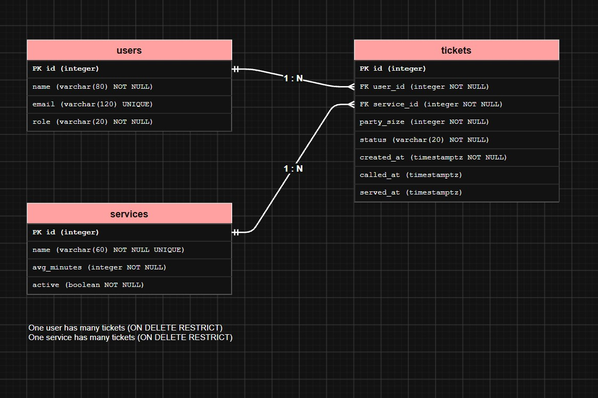

# CinemaTicketQ schema design (Week 4)

## 2a. Nouns in the requirements that store data

| Req ID | Requirement | Nouns | Table or column? |
| --- | --- | --- | --- |
| FR-01 | A **person** can join the queue by entering their **name**, an optional **email**, a **service** and a **party size**. | person, name, email, service, party size | users, users.name, users.email, services, tickets.party_size |
| FR-02 | A person can see their **ticket number**, **status** and how many people are **ahead**. | ticket number, status, ahead | tickets.id, tickets.status, *(computed)* |
| FR-03 | A person can see an **estimated wait** and the expected **clock time**. | estimated wait, clock time | *(computed)* |
| FR-04 | Staff can see the **waiting list** in the **order** people joined. | waiting list, order | *(not a table: tickets with status waiting)*, tickets.created_at |
| FR-05 | Staff can **call** the next waiting ticket. | call | tickets.status, tickets.called_at |
| FR-06 | Staff can mark a called ticket **served** or **no-show**. | served, no-show | tickets.status, tickets.served_at |
| FR-07 | A person can **leave** the queue; the ticket is kept as **left**. | left | tickets.status |
| FR-09 | Staff can add, rename and switch off a **service**. | service, name, active | services.name, services.active |
| FR-10 | A group joins with a **party size** of 1 to 10. | party size | tickets.party_size |
| FR-12 | Staff can see how many people **left** before being served, per service, per **day**. | left, day | tickets.status, *(computed from created_at)* |
| FR-13 | Staff can **delete** a mistaken ticket. | ticket | tickets (hard delete) |
| FR-14 | The estimate uses the **average time per person** of the last 10 served tickets, or the service's **avg_minutes**. | average time, avg_minutes | *(computed from called_at and served_at)*, services.avg_minutes |

- **The queue is not a table.** It is all tickets with status `waiting` for one service, ordered by `created_at`.
- **Store facts, not results.** Position, wait time, the estimate and the "3 or fewer ahead" warning (FR-15) are all computed. No `position` or `estimated_wait` column exists.

## 2b. Tables and columns

| Table | Columns |
| --- | --- |
| `users` | id, name, email, role |
| `services` | id, name, avg_minutes, active |
| `tickets` | id, user_id, service_id, party_size, status, created_at, called_at, served_at |

Where each Week 3 field went:

- **Name and email** are facts about the person, so they go in `users`.
- **Party size** may change every visit, so it goes in `tickets` (the ★ field for FR-10).
- **called_at and served_at** are facts about one visit, so they go in `tickets`. They give the time per person for FR-14.
- **avg_minutes and active** are facts about the service.

A fourth table is not required. If I add one later, it would be `booths` (counter number), with `tickets.booth_id`.

## 2c. Types and constraints

| Table | Column | PostgreSQL type | Constraint | Why |
| --- | --- | --- | --- | --- |
| users | id | integer, generated | PRIMARY KEY | Generated by the database, never reused |
| users | name | varchar(80) | NOT NULL | Staff need a name to call |
| users | email | varchar(120) | UNIQUE (nullable) | Email is optional (FR-01); many NULLs are allowed, but two people cannot share one email |
| users | role | varchar(20) | NOT NULL DEFAULT 'visitor', CHECK (role IN ('visitor', 'staff')) | Only two roles exist |
| services | id | integer, generated | PRIMARY KEY | Generated by the database |
| services | name | varchar(60) | NOT NULL UNIQUE | No two services with the same name |
| services | avg_minutes | integer | NOT NULL DEFAULT 3, CHECK (avg_minutes > 0) | Starting estimate per person; rejects impossible values |
| services | active | boolean | NOT NULL DEFAULT true | Switch a service off without losing its tickets (FR-09) |
| tickets | id | integer, generated | PRIMARY KEY | The ticket number; never reused (NFR-02) |
| tickets | user_id | integer | NOT NULL REFERENCES users(id) ON DELETE RESTRICT | Every ticket belongs to a person |
| tickets | service_id | integer | NOT NULL REFERENCES services(id) ON DELETE RESTRICT | No ticket for a missing service |
| tickets | party_size | integer | NOT NULL DEFAULT 1, CHECK (party_size BETWEEN 1 AND 10) | Matches the join form (FR-10) |
| tickets | status | varchar(20) | NOT NULL DEFAULT 'waiting', CHECK (status IN ('waiting', 'called', 'served', 'no-show', 'left')) | Only five allowed states |
| tickets | created_at | timestamptz | NOT NULL DEFAULT now() | Time-zone safe; set by the database; defines queue order |
| tickets | called_at | timestamptz | nullable | Empty until staff call the ticket |
| tickets | served_at | timestamptz | nullable, CHECK (served_at IS NULL OR called_at IS NULL OR served_at >= called_at) | Empty until served; cannot be earlier than the call (FR-14) |

All six required features are used: PRIMARY KEY, FOREIGN KEY, NOT NULL, UNIQUE, CHECK and `timestamptz`.

## 2d. ERD

**Relationships, read aloud:**

- One user has many tickets (1 : N). A person who returns with the same email gets a new ticket, not a new account.
- One service has many tickets (1 : N).
- Each ticket belongs to exactly one user and one service.
- The foreign key always sits on the "many" side, so `user_id` and `service_id` are in `tickets`.

**Delete rules:**

| Foreign key | Rule | Reason |
| --- | --- | --- |
| tickets.user_id → users.id | RESTRICT | Old tickets are needed for reports (FR-12), so a user with tickets cannot be deleted |
| tickets.service_id → services.id | RESTRICT | A service with tickets cannot be deleted; staff switch it off instead (`active = false`) |

Deleting one ticket by hand (FR-13) is allowed. Nothing points at a ticket, so no other row is affected.

## 2e. Normalization

1. **One value per cell (1NF):** Yes, every cell holds one value. No column holds a list such as "Buy tickets, Refund".
2. **Depends on the whole key (2NF):** There is no join table, and every table has a single-column primary key, so this holds.
3. **No hidden copies (3NF):** A person's name and email are stored once in `users`, and a service's name once in `services`. Tickets only hold the ids. Position, wait time and the estimate are computed, so they are never copied anywhere.

**Known limit:** because email is optional, a person who gives no email gets a new `users` row on every visit. That is acceptable here, since there is nothing to match them on, but it means anonymous visitors cannot be linked across visits.